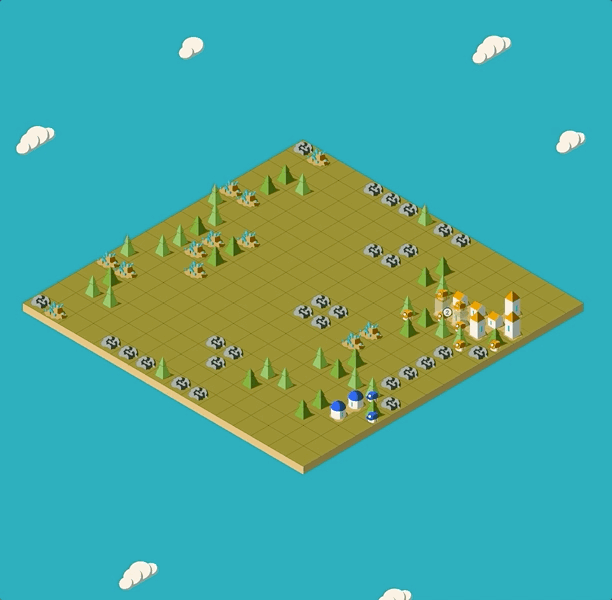

# Spiti Exclusion Zone -- Battle Visualizer

**The Lazarus Missions 2026** | Track 4: Spiti Exclusion Zone | IEEE NITK

An interactive isometric battle replay visualizer for the [Spiti Exclusion Zone](https://www.kaggle.com/competitions/spiti/overview) Kaggle competition. Watch any of the 329 recorded enemy encounters play out turn by turn, with full day/night cycle rendering, resource tracking, and outpost construction.

**Live site:** https://spiti-tlm2026.vercel.app



---

## Overview

This tool lets competition participants upload a replay JSON and watch the enemy AI's drone decisions play out visually -- outposts being built, supplies being transferred, drones moving across the wasteland grid before each radiation storm.

It is part of **The Lazarus Missions (TLM) 2026**, an AI/ML competition run by:
- **CIS** -- Computer Intelligence Society, NITK
- **CompSoc** -- IEEE Computer Society, NITK
- **IEEE NITK**

---

## Usage (Participants)

1. Download the dataset from the competition page
2. Run the helper script to extract a replay file:

```bash
# View a specific game
python to_viz.py --game_id 5

# List all 329 available games
python to_viz.py --list

# Custom replays directory
python to_viz.py --game_id 42 --replays_dir replays/ --output battle.json
```

3. Upload the output `.json` file at https://spiti-tlm2026.vercel.app

---

## Controls

- **Click and drag** or **WASD** -- pan around the map
- **Scroll** -- zoom in/out
- **Slider** -- scrub to any turn
- **Play/Pause/Speed** -- control playback
- **Left panel tab** -- toggle TLM branding panel

---

## Local Development

Requires Node.js. The build uses webpack 4 and needs the OpenSSL legacy provider on Node 17+.

```bash
npm install
NODE_OPTIONS=--openssl-legacy-provider npm run dev
```

Then open http://localhost:3000/dist

**Production build:**

```bash
NODE_OPTIONS=--openssl-legacy-provider npm run build
```

Output is in `dist/`.

---

## Deployment

Deployed on Vercel. The `vercel.json` at the repo root configures the build:

```bash
vercel --prod
```

---

## Tech Stack

- **React** + **TypeScript**
- **Phaser 3** (isometric game rendering via phaser3-plugin-isometric)
- **Recharts** (statistics charts)
- **Material UI** (controls)
- **webpack 4**

---

## License

MIT
